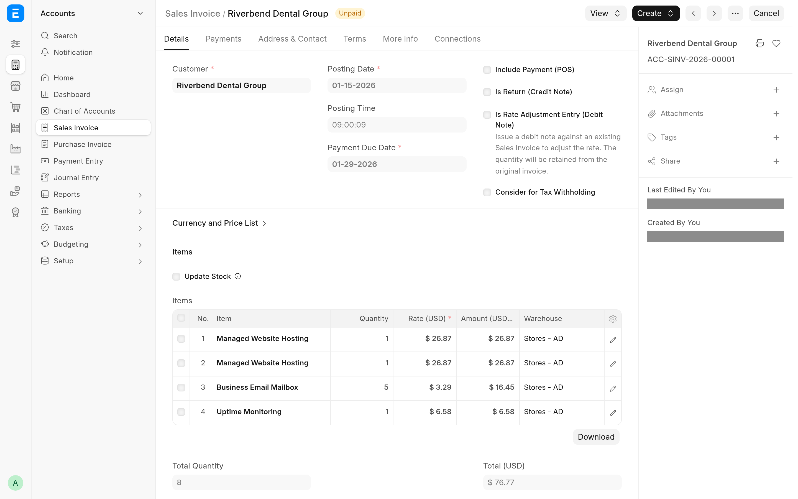

<!-- Copyright (c) 2026, Avunu LLC and contributors
For license information, please see license.txt-->

<!-- frappe-nix:begin header -->

<div align="center">


# Automated Subscriptions

Subscription auto-billing for ERPNext: payment requests, anchors and proration

[](https://github.com/Avunu/automated_subscriptions/actions/workflows/ci.yml)
[](https://github.com/Avunu/automated_subscriptions/releases)
[](license.txt)
[](https://github.com/frappe/frappe/tree/version-16)

<picture>
  <source media="(prefers-color-scheme: dark)" srcset="docs/screenshots/consolidated-invoice-dark.webp">
  
</picture>

</div>

<!-- frappe-nix:end header -->

## Overview

ERPNext's Subscription module makes a Sales Invoice every billing period, but it does not collect the money. For a
direct-debit gateway such as GoCardless, where the customer has already signed a mandate, nothing tells the gateway
to charge that mandate for the new invoice. This app closes that gap: when a Sales Invoice that bills a Subscription
is submitted, it raises a Payment Request for the outstanding amount and, when the gateway supports it, charges the
customer's existing mandate straight away.

It also has an opt-in billing engine for businesses that sell many small recurring services to the same customer:
calendar or anniversary billing anchors with day-accurate proration, one consolidated invoice per customer per due
date, and credit notes for mid-term cancellations. The engine is switched on per customer; a customer with none of
its fields set is billed by stock ERPNext.

## Features

- **Payment Requests for subscription invoices.** Every submitted subscription invoice with an outstanding amount
  gets a Payment Request through the gateway set on its plans. With a gateway that takes the payment itself, such as
  GoCardless with a mandate, the request is submitted without e-mailing the customer.
- **Safe defaults.** Credit notes and fully paid invoices are skipped, an invoice whose due date is too far in the
  past is left as a draft Payment Request for review, and a site-level kill switch stops all automatic charging.
- **Billing anchors.** Align a customer's subscriptions to calendar months or years, or to an anniversary date, with
  the first period prorated by calendar days. Monthly plans can be billed yearly with a discount.
- **Consolidated invoices.** Bill every subscription of a customer that falls due on the same day on one Sales
  Invoice, one line per subscription, each line recording the plan and the exact period it bills.
- **Credit notes on cancellation.** Cancelling a subscription that was billed in advance credits the unused days.
- **Service Identifier.** A free-text field on Subscription (a site, a domain, a seat pool), shown in the list,
  searchable, and used as the invoice line description.
- **Process Subscription per customer.** An optional Customer field limits a Process Subscription run to one
  customer.

<!-- frappe-nix:begin compatibility -->

## Compatibility

| Frappe | Branch       |
| ------ | ------------ |
| v16    | `version-16` |

| Requires                                       | Version            |
| ---------------------------------------------- | ------------------ |
| [erpnext](https://github.com/frappe/erpnext)   | `>=16.0.0,<17.0.0` |
| [payments](https://github.com/frappe/payments) | `>=0.0.1,<1.0.0`   |

<!-- frappe-nix:end compatibility -->

<!-- frappe-nix:begin installation -->

## Installation

On Frappe Cloud, install Automated Subscriptions from the [Frappe marketplace](https://cloud.frappe.io/marketplace/apps/automated_subscriptions).

On a bench of your own:

```bash
bench get-app https://github.com/Avunu/automated_subscriptions --branch version-16
bench --site <site> install-app automated_subscriptions
```

<!-- frappe-nix:end installation -->

Until the first release creates the `version-16` branch, install from `develop` instead:
`bench get-app https://github.com/Avunu/automated_subscriptions --branch develop`.

The app needs ERPNext and the [Frappe Payments](https://github.com/frappe/payments) app (both are in
`required_apps`, so install them on the site first) and Python 3.14 or newer. It is developed and tested against
ERPNext 16.34.2 and Frappe 16.33.1. Installation adds the custom fields described below and an index on
`Sales Invoice.subscription`; sites that already have the app get the index from a patch on the next
`bench migrate`.

## Configuration

### Charging subscription invoices

1. Set up the gateway in Frappe Payments, with a **Payment Gateway Account**.
2. On each **Subscription Plan** that should be charged automatically, set **Payment Gateway** to that account. A
   plan with no gateway is never charged.
3. Make sure the customer has an active mandate (or equivalent authorisation) with the gateway.

Nothing else is needed for the Payment Requests.

### Subscription Settings

The app adds an **Automated Subscriptions** section to **Subscription Settings**:

| Field                           | Default   | Effect                                                                                                                                                                        |
| ------------------------------- | --------- | ----------------------------------------------------------------------------------------------------------------------------------------------------------------------------- |
| Auto-charge Max Lateness (days) | 30        | A subscription invoice whose due date is more than this many days in the past is not charged; its Payment Request is left as a draft.                                         |
| Annual Discount Percentage      | 16.67     | Used when a monthly plan is billed on a yearly term: yearly rate = monthly rate x 12 x (1 - discount).                                                                        |
| Credit Note On Cancellation     | on        | On mid-term cancellation of an anchored or consolidated subscription, issue a Credit Note for the unused part of the period.                                                  |
| Mid-term Billing Mode           | Immediate | For an anchored or consolidated subscription added mid-term: bill the prorated first invoice when the subscription is created (Immediate), or leave it to the next daily run. |
| Auto-billing Delay              | 0         | Not read by the current code (see Limitations).                                                                                                                               |

The defaults are written to the database on install and on every `bench migrate`, so the form and the engine see the
same values.

### Per-customer billing engine

The **Subscription Billing** section on the **Customer** form controls the engine. With every field blank the
customer is billed by stock ERPNext.

| Field                             | Effect                                                                                                                                                                        |
| --------------------------------- | ----------------------------------------------------------------------------------------------------------------------------------------------------------------------------- |
| Consolidate Subscription Invoices | Bill every subscription of this customer that is due on the same day on one invoice. Off by default, including for existing customers.                                        |
| Subscription Billing Anchor       | Blank: stock behaviour. **Calendar**: periods follow calendar months or years. **Anniversary**: periods follow the day (and, for yearly terms, the month) of the anchor date. |
| Subscription Billing Anchor Date  | Shown and required for Anniversary, cleared otherwise. Periods end the day before the date's next occurrence.                                                                 |
| Subscription Billing Interval     | Shown and kept only when an anchor is set. Blank: each plan's own interval. **Year**: bill monthly plans once a year at 12 x monthly x (1 - Annual Discount Percentage).      |

### Kill switch

Add `"subscription_auto_charge_disabled": 1` to the site's `site_config.json` to stop automatic charging on that
site. The setting lives in the site directory and is not restored with a database backup, so a restored staging
copy does not charge live mandates.

## How It Works

### Payment Requests

An `on_submit` hook on Sales Invoice creates a Payment Request when all of these hold:

- the invoice bills a Subscription, by its header link or by any line link;
- it is not a return and its outstanding amount is greater than zero;
- the kill switch is not set, and the site is not migrating, patching, installing or importing data;
- exactly one payment gateway follows from the plans on the invoice (plans without a gateway ride along with one
  that has it; no gateway means no charge; two different gateways are written to the Error Log and left to a
  person);
- the due date is not older than **Auto-charge Max Lateness**.

The Payment Request is dated on the invoice's due date, so a late-running scheduler still charges. If the gateway
takes the payment itself, as GoCardless does for a mandate, the request is submitted without an e-mail; otherwise it
is submitted normally and the customer is notified. An invoice that is too old gets a draft Payment Request with a
comment and an Error Log entry.

### Anchored billing and proration

For a customer with a billing anchor, each period ends the day before the next anchor date. A subscription that
starts mid-term is billed for the stub first, at the plan rate prorated by calendar days (billed days divided by the
days in the term; a full term is never rounded). Prorated invoices ignore Pricing Rules, which would otherwise
overwrite the prorated rate on every save, so move customer-specific pricing onto the plan before anchoring such a
customer. Anniversary days that do not exist in a month (the 31st, February 29th) fall on the month's last day.

### Consolidated billing

For a consolidating customer, ERPNext's daily Process Subscription hands the customer's due subscriptions to the
runner in `billing/runner.py`; there is no second scheduler job. The runner groups them by everything that ends up
on the invoice header (company, currency, tax template, cost center, accounting dimensions, posting date, submit
flag, trial state, additional discounts, days until due), takes a lock per customer, bills each group on one Sales
Invoice with a line per subscription, and submits it once, so one invoice raises one Payment Request. Each group
runs in its own savepoint: a failure rolls that group back, is written to the Error Log, and does not stop other
customers.

A dry run builds the real invoices and rolls them back:

```sh
bench --site your-site.example execute \
  automated_subscriptions.automated_subscriptions.billing.runner.preview_consolidated_billing
```

`run_consolidated_billing` takes the same arguments (`posting_date`, `party`, `party_type`, `company`) and creates
the invoices.

### Cancellation with a credit note

When the customer is anchored or consolidating, **Credit Note On Cancellation** is on and the subscription is billed
in advance (any **Generate Invoice At** other than the end of the period), cancelling it issues one Credit Note per source invoice for the unused days of every
billed line, instead of ERPNext's invoice for the days used. The cancel date is the last billed day. The credit is
left as unallocated customer credit: the original invoice is untouched and no refund is sent to the gateway. A line
that has been credited already is refused rather than credited twice.

## Limitations

- Customer subscriptions only; supplier (purchase) subscriptions are never anchored or consolidated.
- Anchoring supports plans billed in months or years. Day and Week plans, plans priced by Monthly Rate, and monthly
  plans whose month count does not divide a year (when the customer is billed yearly) cannot be anchored, and
  **Follow Calendar Months** cannot be combined with an anchor. These are refused on save rather than billed wrongly.
- A consolidated invoice needs one payment gateway. If its plans point to different gateways, no automatic charge is
  made.
- Backdated start dates are checked for anchored and consolidating customers. A start date in a billing period that
  has already ended is refused unless **Generate New Invoices Past Due Date** is on, and when catch-up billing is
  left to the daily run, a start date a full billing cycle or more before the first period end is refused too. To
  load history, insert with `frappe.flags.in_import` set and replay the elapsed periods with Process Subscription and
  a past posting date.
- No credit notes for subscriptions billed at the end of the period (those get ERPNext's invoice for the days
  used), and no gateway refunds.
- With the stock Frappe Payments app, GoCardless charges a mandate but does not settle the invoice: its webhooks only
  track mandates, so the Payment Entry for a collected payment is made by hand (or by a payments build that handles
  payment events).
- Two lines with the same item and description cannot share a consolidated invoice unless Selling Settings allows an
  item to be added more than once; give each subscription its own Service Identifier.
- **Auto-billing Delay** in Subscription Settings is a leftover field; changing it has no effect.

<!-- frappe-nix:begin support -->

## Support

- Bug reports and questions: [GitHub issues](https://github.com/Avunu/automated_subscriptions/issues)
- E-mail: <mail@avu.nu>

<!-- frappe-nix:end support -->

<!-- frappe-nix:begin development -->

## Development

```bash
nix develop        # or: direnv allow
prek install       # the git hooks CI runs
frappe-test        # the tests, the way CI runs them
```

The managed files, checks and release flow are described in the [app standards documentation](https://docs.avunu.net/frappe-nix/docs/app-standards/).

<!-- frappe-nix:end development -->

The code layout, the test fixtures and the design decisions behind the engine are described in
[docs/development.md](docs/development.md) and [docs/DECISIONS.md](docs/DECISIONS.md).

<!-- frappe-nix:begin license -->

## License

MIT, Copyright (c) 2024–present Avunu LLC → [license.txt](license.txt)

<!-- frappe-nix:end license -->
