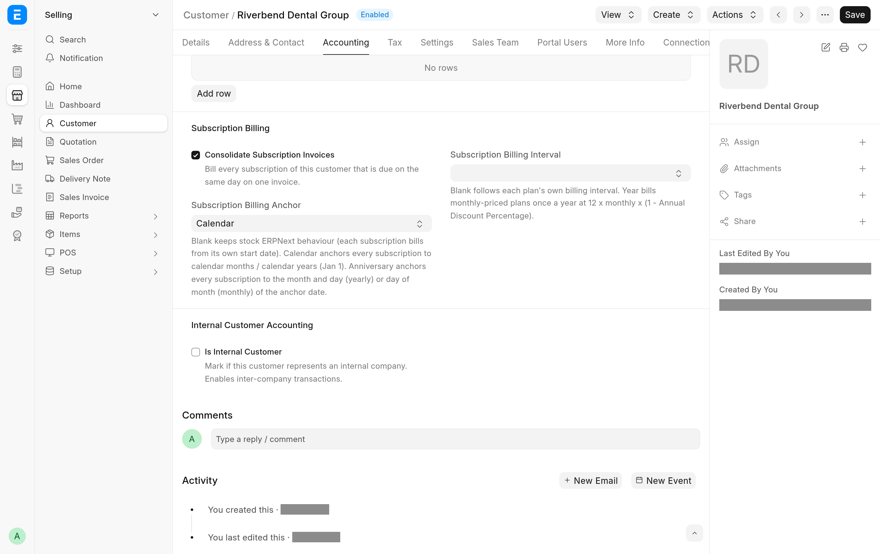

By default ERPNext bills each subscription from its own start date, so a customer with ten subscriptions has ten billing dates. A billing anchor puts all of a customer's subscriptions on the same dates. A subscription that starts between two anchor dates is billed first for the days up to the next anchor date, at a prorated rate, and then for full periods.

## Anchor a customer

1. Open the **Customer** and go to the **Subscription Billing** section on the **Accounting** tab.
2. Set **Subscription Billing Anchor**:
   - **Calendar**: periods follow calendar months, or calendar years starting on 1 January.
   - **Anniversary**: periods follow a date of your choice. Set **Subscription Billing Anchor Date**; the save is refused without it.
3. Optionally set **Subscription Billing Interval** to **Year** to bill the customer's monthly plans once a year (see [Bill monthly plans yearly](#bill-monthly-plans-yearly)). Leave it blank, or set **Month**, to bill each plan on its own interval.
4. Save.

To go back to stock billing, clear **Subscription Billing Anchor**. The anchor date and the interval are cleared with it on save.



## How periods are cut

Each period ends the day before the next anchor date.

| Anchor      | Monthly plan                                                           | Yearly plan                                                        |
| ----------- | ---------------------------------------------------------------------- | ------------------------------------------------------------------ |
| Calendar    | 1st of the month to the last day of the month                          | 1 January to 31 December                                           |
| Anniversary | The anchor date's day of the month to the day before it, a month later | The anchor date's day and month to the day before it, a year later |

A plan with a **Billing Interval Count** above 1 takes that many months or years per period. Under a Calendar anchor, a 3-month plan bills calendar quarters (January, April, July and October).

On an Anniversary anchor, a day that a month does not have falls on the month's last day: an anchor on the 31st gives 30 April and 28 February, and an anchor on 29 February gives 28 February in other years.

A trial period and a **Subscription End Date** still apply: while the subscription is in its trial, the period ends on the trial end date, and no period runs past the end date.

## Proration

A period shorter than a full term, such as the first period of a subscription that starts between anchor dates, is billed at the plan rate times billed days divided by the days in the term the period falls in. Both are calendar days, counting the first and last day. A full term is billed at exactly the plan rate, never a rounded fraction of it.

For example, under a Calendar anchor, a monthly plan of 49.00 that starts on 15 January is billed for 15 to 31 January at 49.00 x 17 / 31 = 26.87, and from 1 February for full months.


With **Prorate** off in **Subscription Settings**, a short period is billed at the full plan rate.

> [!IMPORTANT]
> The invoices the engine makes for an anchored customer ignore Pricing Rules. A Pricing Rule would otherwise overwrite the prorated rate each time the invoice is saved. If an anchored customer has customer-specific prices in Pricing Rules, move that pricing onto the plan (or onto a plan of its own) before you anchor the customer.

## Bill monthly plans yearly

With **Subscription Billing Interval** set to **Year**, a monthly plan is billed once a year, on the yearly anchor, at:

```text
yearly rate = monthly rate x 12 x (1 - Annual Discount Percentage / 100)
```

**Annual Discount Percentage** is in **Subscription Settings** and is 16.67 (two months free) by default. A plan of 2, 3, 4 or 6 months is billed 6, 4, 3 or 2 times its rate a year, less the same discount. Yearly plans are billed as they are, without a discount.

## Changing the anchor of an existing customer

The anchor applies to the customer's existing subscriptions too. At the next billing run, a subscription whose stored period does not match the anchor keeps its current start date and gets the anchored end date, so its next invoice is a prorated short period up to the anchor date. From then on it bills full anchored periods.

## When a new subscription is billed

**Mid-term Billing Mode** in **Subscription Settings** decides when the first, prorated invoice of a new subscription of an anchored customer is made:

- **Immediate** (the default): when the subscription is saved, as stock ERPNext does. A subscription that starts in the future is billed by the daily run once its start date comes.
- **Next Daily Run**: by ERPNext's daily Process Subscription job.

## Backdated start dates

ERPNext's daily run bills at most one period past the current period, and then starts the period again from the run date, so a subscription created with a start date far in the past would lose periods. The app refuses such a subscription when you save it, for an anchored customer:

- If the start date lies in a billing period that has already ended, the save is refused unless **Generate New Invoices Past Due Date** is ticked on the Subscription. With it ticked and **Mid-term Billing Mode** on **Immediate**, saving the subscription bills every elapsed period.
- With **Mid-term Billing Mode** on **Next Daily Run**, the save is also refused when today is one full billing period or more past the end of the first period. Ticking **Generate New Invoices Past Due Date** does not lift this check.

To load subscriptions with a history, see [Load subscriptions with a history](run-billing.md#load-subscriptions-with-a-history).

## What cannot be anchored

The app refuses these rather than billing them wrongly:

- Plans with a **Billing Interval** of Day or Week.
- Plans priced by **Monthly Rate** in **Subscription Price Based On**.
- With **Subscription Billing Interval** set to **Year**, monthly plans whose **Billing Interval Count** does not divide 12 (5, 7, 8 and so on).
- **Follow Calendar Months** on the Subscription.
- Supplier subscriptions: only customers are anchored.

A new subscription that breaks one of these rules cannot be saved. An existing subscription that breaks one, because its customer was anchored later, is not billed: the daily run writes the error to the Error Log each day until you fix the plan or the subscription. The messages are in [Troubleshooting](troubleshooting.md#anchored-billing).
