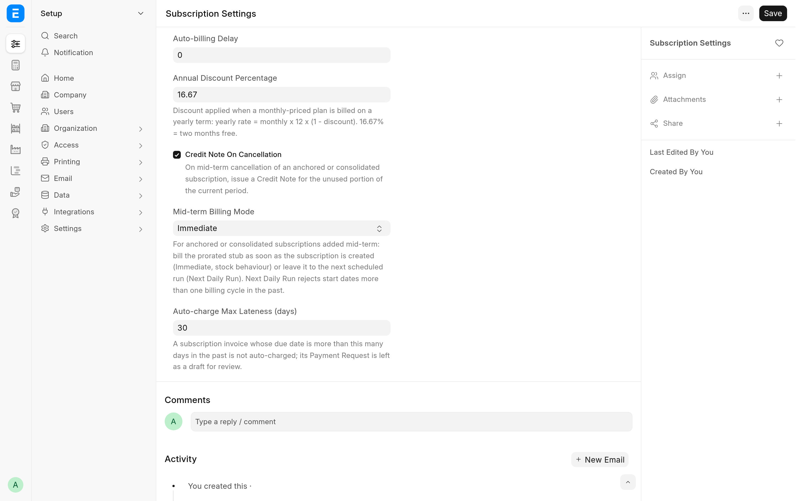
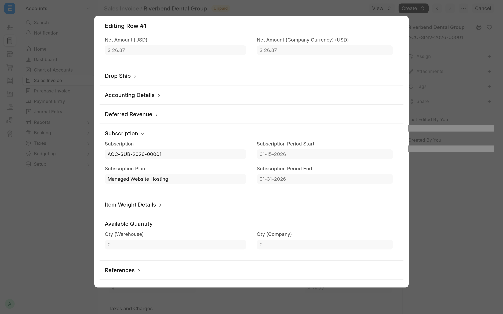

Automated Subscriptions has no settings page of its own. It is configured through four fields it adds to **Subscription Settings**, four fields on each **Customer**, the **Payment Gateway** of each **Subscription Plan**, and one site configuration key. This page lists them, then lists everything the app adds to your site.

## Subscription Settings

The app adds an **Automated Subscriptions** section to **Subscription Settings**, below ERPNext's **Prorate**.



| Setting                             | Default   | What it does                                                                                                                                                                                                                                                                                    |
| ----------------------------------- | --------- | ----------------------------------------------------------------------------------------------------------------------------------------------------------------------------------------------------------------------------------------------------------------------------------------------- |
| **Annual Discount Percentage**      | 16.67     | The discount when a monthly plan is billed on a yearly term: yearly rate = monthly rate x 12 x (1 - discount). 16.67% is two months free. Used only for customers whose **Subscription Billing Interval** is **Year**.                                                                          |
| **Credit Note On Cancellation**     | On        | Cancelling a subscription of an anchored or consolidating customer issues a Credit Note for the unused part of the period. Off, every cancellation follows ERPNext. See [Cancel with a credit note](cancellation.md).                                                                           |
| **Mid-term Billing Mode**           | Immediate | How the first, prorated invoice of a new subscription of an anchored or consolidating customer is billed. **Immediate** bills it when the subscription is created (for a consolidating customer, in a background job right after the save). **Next Daily Run** leaves it to the next daily run. |
| **Auto-charge Max Lateness (days)** | 30        | A subscription invoice whose due date is more than this many days in the past is not charged: its Payment Request is left as a draft. See [Charge subscription invoices](payment-requests.md#invoices-that-are-too-late).                                                                       |

The defaults are written to the database when the app is installed and on every `bench migrate`, so the form and the billing code see the same values. A value you saved is never overwritten.

ERPNext's own settings on the same page still apply. **Grace Period** and **Cancel Subscription After Grace Period** decide when an unpaid subscription becomes Unpaid or Cancelled. **Prorate** decides whether a cancellation invoice is prorated; for an anchored customer it also decides whether the first, partial period is prorated (off, the first period is billed at the full plan rate).

There is no setting for a delay before a payment is collected. When the money is collected comes from **Days Until Due** on each Subscription: see [When the customer is charged](payment-requests.md#when-the-customer-is-charged).

## Customer: Subscription Billing

The **Subscription Billing** section on the **Accounting** tab of the **Customer** form switches the billing engine on for that customer. With every field blank or off, the customer is billed by stock ERPNext.

| Field                                 | Default | What it does                                                                                                                                                                                                                                 |
| ------------------------------------- | ------- | -------------------------------------------------------------------------------------------------------------------------------------------------------------------------------------------------------------------------------------------- |
| **Consolidate Subscription Invoices** | Off     | Bill every subscription of this customer that is due on the same day on one invoice. See [Consolidate invoices](consolidated-invoices.md).                                                                                                   |
| **Subscription Billing Anchor**       | Blank   | Blank keeps stock behaviour. **Calendar** makes periods follow calendar months or years. **Anniversary** makes them follow the day (and, for yearly terms, the month) of the anchor date. See [Anchor billing periods](anchored-billing.md). |
| **Subscription Billing Anchor Date**  | Blank   | Shown and required for **Anniversary**, cleared on save otherwise. Periods end the day before the date's next occurrence.                                                                                                                    |
| **Subscription Billing Interval**     | Blank   | Shown only when an anchor is set, and cleared on save when it is not. Blank or **Month** follows each plan's own interval. **Year** bills monthly plans once a year at 12 x monthly x (1 - **Annual Discount Percentage**).                  |

## Subscription Plan and Subscription

These ERPNext fields decide what the app does with a subscription.

| Field                                   | Where             | What it does here                                                                                                                                                                                                       |
| --------------------------------------- | ----------------- | ----------------------------------------------------------------------------------------------------------------------------------------------------------------------------------------------------------------------- |
| **Payment Gateway**                     | Subscription Plan | The **Payment Gateway Account** that charges invoices of this plan. A plan without one is never charged automatically.                                                                                                  |
| **Service Identifier**                  | Subscription      | Added by the app. Free text naming what the subscription bills (a site, a domain, a seat pool). It is shown in the list, can be filtered and searched, and becomes the description of the subscription's invoice lines. |
| **Days Until Due**                      | Subscription      | The invoice is due this many days after its posting date, and the Payment Request is dated on that due date. With 0, the invoice's payment terms decide.                                                                |
| **Generate Invoice At**                 | Subscription      | Subscriptions billed at **End of the current subscription period** are not credited on cancellation: they get ERPNext's invoice for the days used.                                                                      |
| **Generate New Invoices Past Due Date** | Subscription      | For an anchored customer, a subscription whose start date lies in a billing period that has already ended can be saved only when this is on. See [Backdated start dates](anchored-billing.md#backdated-start-dates).    |
| **Follow Calendar Months**              | Subscription      | Cannot be combined with a customer billing anchor: the save is refused.                                                                                                                                                 |

## Stop all automatic charging

Add this key to the site's `site_config.json` to stop every automatic charge on that site:

```json
{
	"subscription_auto_charge_disabled": 1
}
```

Or from the bench directory:

```bash
bench --site <SITE_NAME> set-config subscription_auto_charge_disabled 1
```

With the key set, submitting a subscription invoice raises no Payment Request at all. Invoices are still made. Frappe also reads the key from `common_site_config.json`, where it stops charging on every site of the bench.

The key lives in the site's directory and is not part of a database backup. A copy of a live site restored onto a staging bench therefore does not carry it over: set it on the staging site before the copy's scheduler runs, so the copy does not charge live mandates.

## Selling Settings

A consolidated invoice cannot hold two lines with the same item and the same description unless **Allow same Item to be added multiple times in a transaction** is ticked in **Selling Settings**. Giving each subscription its own **Service Identifier** avoids the clash. See [Consolidate invoices](consolidated-invoices.md#service-identifier).

## Permissions

The app adds no roles. It checks these permissions itself:

| Action                                                        | Needs                                                  |
| ------------------------------------------------------------- | ------------------------------------------------------ |
| `run_consolidated_billing` (bill consolidating customers now) | Write on Subscription                                  |
| `preview_consolidated_billing` (dry run)                      | Read on Subscription                                   |
| `cancel_with_credit_note`                                     | Write on the Subscription, and Submit on Sales Invoice |
| **Cancel Subscription** button, when it issues credit notes   | The same as `cancel_with_credit_note`                  |

The Payment Request is made with permissions ignored, so whoever submits the invoice (a user, or the scheduler) does not need rights on Payment Request. The invoices themselves are made by ERPNext's subscription code, as in stock ERPNext.

## What the app adds to your site

This is the complete list, so you can see what a migration changes.

### Fields

| Document              | Fields                                                                                                                                                                                                                                                                                                                                                                                              |
| --------------------- | --------------------------------------------------------------------------------------------------------------------------------------------------------------------------------------------------------------------------------------------------------------------------------------------------------------------------------------------------------------------------------------------------- |
| Customer              | A **Subscription Billing** section after the credit limits, with **Consolidate Subscription Invoices** (`consolidate_subscription_invoices`, Check), **Subscription Billing Anchor** (`subscription_billing_anchor_mode`, Select), **Subscription Billing Anchor Date** (`subscription_billing_anchor_date`, Date) and **Subscription Billing Interval** (`subscription_billing_interval`, Select). |
| Subscription          | **Service Identifier** (`service_identifier`, Data) after **Party**, in the list view and the standard filters.                                                                                                                                                                                                                                                                                     |
| Subscription Settings | An **Automated Subscriptions** section with **Annual Discount Percentage** (Percent), **Credit Note On Cancellation** (Check), **Mid-term Billing Mode** (Select) and **Auto-charge Max Lateness (days)** (`auto_charge_max_lateness_days`, Int).                                                                                                                                                   |
| Sales Invoice Item    | A collapsible **Subscription** section after the deferred revenue dates, with **Subscription** (`subscription`, Link, indexed), **Subscription Plan** (`subscription_plan`, Link), **Subscription Period Start** and **Subscription Period End** (Date). All are read-only and hidden from print.                                                                                                   |
| Process Subscription  | **Customer** (`customer`, Link) after **Subscription**: "Limit this run to the subscriptions of one customer."                                                                                                                                                                                                                                                                                      |



### Property setters

| Document      | Change                                                                                             |
| ------------- | -------------------------------------------------------------------------------------------------- |
| Subscription  | **Search Fields** set to `party, service_identifier`.                                              |
| Sales Invoice | The header **Subscription** field is indexed. The index itself is added at install and by a patch. |

### Behaviour

| Where                | How                                                         | What it does                                                                                                                                                                                                                                                                                                       |
| -------------------- | ----------------------------------------------------------- | ------------------------------------------------------------------------------------------------------------------------------------------------------------------------------------------------------------------------------------------------------------------------------------------------------------------ |
| Customer             | `doc_events`, `validate`                                    | Requires **Subscription Billing Anchor Date** for Anniversary, clears it for any other anchor, and clears **Subscription Billing Interval** when no anchor is set.                                                                                                                                                 |
| Sales Invoice        | `doc_events`, `on_submit`                                   | Raises (and, when the gateway supports it, charges) the Payment Request for a subscription invoice. See [Charge subscription invoices](payment-requests.md).                                                                                                                                                       |
| Sales Invoice        | `doc_events`, `before_validate`, and `extend_doctype_class` | Makes the invoices of anchored customers that the billing engine creates ignore Pricing Rules, so the prorated rate survives the save.                                                                                                                                                                             |
| Sales Invoice        | `doc_events`, `on_cancel`, and `extend_doctype_class`       | When an invoice is cancelled, or a payment against it is submitted or cancelled, refreshes the status of every subscription the invoice bills, not only the one in its header.                                                                                                                                     |
| Subscription         | `extend_doctype_class`                                      | Anchored periods and proration, consolidated billing, credit notes on **Cancel Subscription**, the backdated start checks, and lookups that find a subscription's invoices by header or line link. A customer with no billing fields set gets ERPNext's own behaviour, apart from the line links and descriptions. |
| Process Subscription | `extend_doctype_class`                                      | With **Customer** set, processes only that customer's subscriptions, in one background job on the long queue.                                                                                                                                                                                                      |

The app adds no scheduled job. ERPNext's daily Process Subscription job bills consolidating customers too, through the extended Subscription class.

### Whitelisted methods

| Method                                                                                        | What it does                                                                                                          |
| --------------------------------------------------------------------------------------------- | --------------------------------------------------------------------------------------------------------------------- |
| `automated_subscriptions.automated_subscriptions.billing.runner.run_consolidated_billing`     | Bills every due subscription of consolidating customers now. See [Run and preview billing](run-billing.md).           |
| `automated_subscriptions.automated_subscriptions.billing.runner.preview_consolidated_billing` | The same, as a dry run that saves nothing.                                                                            |
| `automated_subscriptions.automated_subscriptions.billing.credit_note.cancel_with_credit_note` | Cancels a subscription on a given date and credits the unused days. See [Cancel with a credit note](cancellation.md). |

The extended classes also re-declare three methods that ERPNext already whitelists, so the desk keeps calling them: `cancel_subscription` and `process` on Subscription, and `set_missing_values` on Sales Invoice.

## Related

- [Install and upgrade](install.md)
- [How it works](development/architecture.md) for the code behind each row above
