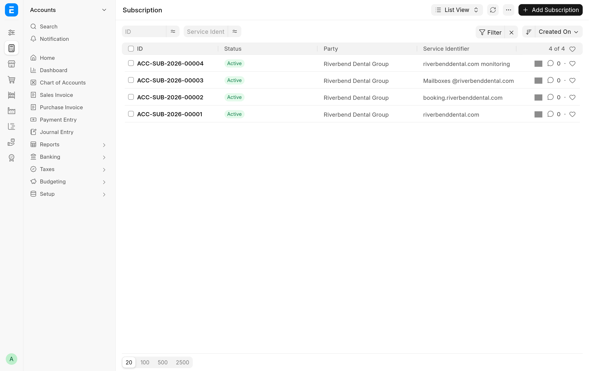

Stock ERPNext makes one Sales Invoice per subscription. A customer with a hosting plan, five mailboxes and a monitoring plan gets three invoices, three Payment Requests and three charges each month. With consolidation on, the app bills all of that customer's subscriptions that fall due on the same day on one invoice, submits it once and so raises one Payment Request.

Consolidation and [billing anchors](anchored-billing.md) are separate switches. They work best together, because an anchor puts all of a customer's subscriptions on the same dates, but a customer can consolidate without an anchor: the subscriptions that happen to fall due on the same day are then billed together.

## Turn it on for a customer

1. Open the **Customer** and go to the **Subscription Billing** section on the **Accounting** tab.
2. Tick **Consolidate Subscription Invoices** and save.

It is off for every customer until you tick it, including customers that existed before the app was installed.

## What the invoice looks like

- One line for each plan of each subscription, in the order the subscriptions were created.
- Each line's **Subscription** section records the **Subscription**, the **Subscription Plan**, and the **Subscription Period Start** and **Subscription Period End** that line bills. Subscriptions on one invoice can bill different periods: a stub and a full month, for example.
- The line's description is the subscription's **Service Identifier** when it has one, and the item's description otherwise.
- The header comes from the oldest subscription on the invoice. Its **From Date** and **To Date** cover every line's period.
- An **Additional Discount Amount** set on the subscriptions is added up over the subscriptions, so the invoice takes off what separate invoices would have. A percentage applies to the whole invoice.

The invoice is submitted only when every subscription on it has **Submit Generated Invoices** ticked. Otherwise it is saved as a draft for you to check and submit.

## Which subscriptions share an invoice

Subscriptions of the same customer share an invoice when they fall due on the same run and everything that goes into the invoice header is the same:

- **Company** and the plan's currency
- **Sales Taxes and Charges Template** and **Cost Center**
- every accounting dimension
- the posting date, which follows from **Generate Invoice At** and the current period
- **Submit Generated Invoices**, and whether the subscription is in its trial
- **Apply Additional Discount On**, **Additional Discount Percentage** and **Additional Discount Amount**
- **Days Until Due**

Subscriptions that differ in any of these go on separate invoices, one for each combination. If you change one of these fields between the start of a run and the moment the customer is billed, that subscription waits for the next run.

## When the invoices are made

- **The daily run.** ERPNext's daily Process Subscription job reaches the customer's first subscription and bills all of the customer's due subscriptions at once. The app adds no scheduled job of its own.
- **A new subscription.** With **Mid-term Billing Mode** on **Immediate**, saving a subscription for a consolidating customer starts a background job on the long queue that bills the customer's due subscriptions straight after the save. With **Next Daily Run**, the next daily run bills it.
- **By hand.** Submit a **Process Subscription** with **Customer** set, or run the billing from the console: see [Run and preview billing](run-billing.md).

A run bills one period per subscription, as stock ERPNext does. A subscription that is more than one period behind gets its next period on the next daily run.

Only one run bills a customer at a time. A second run for the same customer waits up to 60 seconds and then gives up with "Billing for `<CUSTOMER>` is running elsewhere".

## When billing a customer fails

The invoice for a group is built, saved and submitted as one step. If anything in that step fails, the whole group is rolled back, an Error Log titled "Consolidated billing failed: `<CUSTOMER>`" records the cause, and the run goes on with the next customer. None of the failed group's subscriptions are billed on their own instead: they wait until the cause is fixed, and the next run bills them. The common causes are in [Troubleshooting](troubleshooting.md#consolidated-invoices).

## Payment

A consolidated invoice raises one Payment Request, through the gateway of its plans. All the plans on it must point to the same **Payment Gateway**, or to none: if they name different gateways, nothing is charged and the Error Log says so. See [Charge subscription invoices](payment-requests.md).

## Service Identifier

**Service Identifier** is a free-text field the app adds to every Subscription, after **Party**. Use it to say what the subscription bills: a site, a domain, a pool of seats.

- It is a column of the Subscription list and one of its standard filters, and the Subscription search looks in it as well as in **Party**.
- It becomes the description of the subscription's invoice lines, for every customer subscription, consolidated or not.

On a consolidated invoice the identifier also keeps lines apart. ERPNext refuses two lines with the same item and description on one invoice unless **Allow same Item to be added multiple times in a transaction** is ticked in **Selling Settings**. Two subscriptions of the same plan with no identifier, or the same one, have identical lines, and the customer's billing fails. Give each subscription its own identifier, or tick that setting.
